# 03 — Plan de implementación (backlog)

**Fecha:** 2026-10-31. **Presupuesto:** $0 (D8). **Ejecuta:** Lázaro, con sesiones de Claude Code.

**Cómo leer cada tarea:**
- **Pilar:** técnico, entidad, contenido, autoridad externa, medición o canales nuevos.
- **Responsable:**
  - **CC** = Claude Code (una sesión nueva con el prompt de `08`).
  - **L** = Lázaro.
- **Esfuerzo:** **S** hasta 2 h · **M** hasta 1 día · **L** más de 1 día.
- **Impacto (1-5):** efecto esperado sobre las preguntas B2B núcleo (N01-N07 de `06-medicion.md`).
- **Puntaje = Impacto × Confianza ÷ Esfuerzo**:
  - Confianza: alta = 1,0 · media = 0,7 · baja = 0,4.
  - Esfuerzo: S = 1 · M = 2 · L = 3.
  - El puntaje ordena dentro de cada etapa. Entre etapas mandan las **dependencias**: medir antes de cambiar, destrabar antes de todo, posicionamiento antes del contenido y evidencia real antes de la prensa.
- **Evidencia:** se cita la fuente y su fuerza. "(prompt)" quiere decir que viene de la investigación citada en el prompt del 30/10/2026 y no fue re-verificada. "(re-verif.)" quiere decir que la verifiqué el 30 o el 31/10/2026 (`01-auditoria.md` §6).

## Diagrama de dependencias

```mermaid
flowchart TD
  subgraph E0["Etapa 0 · semanas 1-2 · medir y destrabar"]
    V000[VIS-000 secret scanning]
    V001[VIS-001 línea base V0]
    V002[VIS-002 Search Console]
    V003[VIS-003 Bing]
    V004[VIS-004 firewall Vercel]
    V005[VIS-005 prueba de acceso IAs]
    V006[VIS-006 hotfix claims]
    V007[VIS-007 Vercel Analytics]
    V008[VIS-008 ¿Cómo nos conociste?]
    V009[VIS-009 registrar decisiones]
  end
  subgraph E1["Etapa 1 · semanas 2-6 · reenfocar y fijar entidad"]
    V010[VIS-010 robots + slugs]
    V011[VIS-011 fichas sin streaming oculto]
    V012[VIS-012 noindex privadas]
    V013[VIS-013 metadata]
    V014[VIS-014 lastmod + IndexNow]
    V015[VIS-015 grafo JSON-LD]
    V016[VIS-016 home híbrida]
    V017[VIS-017 /para-complejos]
    V018[VIS-018 /precios]
    V019[VIS-019 /nosotros]
    V020[VIS-020 llms.txt]
    V021[VIS-021 perfiles externos]
    V025[VIS-025 efecto red El Vagón]
    V026[VIS-026 fichas: bloque + pie]
  end
  subgraph E2["Etapa 2 · semanas 6-16 · decisión y corroboración"]
    V030[VIS-030 comparativas x4]
    V031[VIS-031 alternativas ATC]
    V032[VIS-032 /funciones x8]
    V034[VIS-034 guía cómo elegir]
    V035[VIS-035 videos]
    V036[VIS-036 reseñas]
    V037[VIS-037 listas de terceros]
  end
  subgraph E3["Etapa 3 · meses 4-12 · escala"]
    V050[VIS-050 herramientas]
    V052[VIS-052 medidor automático $]
    V053[VIS-053 Índice + prensa]
    V054[VIS-054 ciudades ≥3 complejos]
  end
  V001 --> V006 & V010 & V016
  V002 --> V011 & V014
  V004 --> V005
  V009 --> V016 & V017
  V010 --> V019 & V030 & V032
  V011 --> V026
  V013 --> V015
  V015 --> V016 & V017 & V018 & V019
  V017 --> V032 & V030
  V018 --> V030
  V021 --> V015
  V030 --> V034
  V031 --> V034
  V032 --> V035
  V036 -.cuando El Vagón active el plan.-> V036
  V017 --> V050
  V001 --> V052
  V054 -.gate: 3+ complejos por ciudad.-> V054
  V053 -.gate: datos propios.-> V053
```

---

## Etapa 0 — medir y destrabar (semanas 1-2: 01/11 al 14/11/2026)

### VIS-000 · Secret scanning, push protection y regla de PRs · *entidad / seguridad*
- **Por qué:**
  - El repo es público (D7) y tiene el secret scanning apagado (re-verif.: `gh api` → 404 "disabled").
  - Para "TurnoGol", 5 de los 8 primeros resultados son PRs que exponen el precio especial de un cliente (relevamiento del 30/10).
  - **Fuerza alta.**
- **Qué hacer:**
  - GitHub → repo → Settings → Code security: prender **Secret scanning** y **Push protection** (gratis en repos públicos).
  - Regla desde hoy: los títulos y las descripciones de PRs y commits no llevan nombres de clientes ni precios especiales.
  - Barrido (CC, en V1): `grep -riE "precio especial|trial|vence" docs/decisions docs/gtm docs/planning` y reemplazar los precios y fechas de clientes con nombre por "un cliente". Los PRs viejos ya indexados no se reescriben: se acepta el riesgo.
- **Responsable · Esfuerzo · Costo:** L · S · $0.
- **Impacto · Confianza · Puntaje:** 2 · alta · 2,0. Va **primero** por riesgo, fuera de la fórmula.
- **Depende de:** —
- **Aceptación:** `gh api repos/Laza223/turno-gol-repo/secret-scanning/alerts` responde 200 (lista, aunque esté vacía) en vez de 404.
- **KPI:** alertas de secretos abiertas = 0. Ningún PR nuevo con nombres de clientes.

### VIS-001 · Línea base de visibilidad (V0) · *medición*
- **Por qué:**
  - Sin línea base no hay forma de saber si algo funcionó.
  - Se mide por frecuencia, porque el orden de una lista se repite en 1 de cada 1.000 corridas (prompt).
  - **Fuerza alta** como principio.
- **Qué hacer:**
  - CC genera `docs/visibilidad-ia/medicion/` con la plantilla CSV v1, el protocolo en una página y el tablero.
  - L corre la primera semana (32 respuestas) y la primera mensual (unas 87) **antes de tocar el sitio**. Protocolo en `06-medicion.md` §3.
- **Responsable · Esfuerzo · Costo:** CC (S) + L (S, ~3 h) · $0.
- **Impacto · Confianza · Puntaje:** 3 · alta · 3,0.
- **Depende de:** —
- **Aceptación:** la planilla tiene 32 o más filas de la semana 2026-W45 y unas 87 de la mensual, con el set v1.
- **KPI:** presencia, cita, exactitud y confusión de la línea base.

### VIS-002 · Google Search Console como propiedad de dominio · *técnico*
- **Por qué:**
  - Es gratis y obligatorio para ver la indexación y el reporte de IA generativa (re-verif.).
  - Gemini, AI Overviews y AI Mode usan el índice de Google (prompt).
  - **Fuerza alta.**
- **Qué hacer:** pasos 1 a 6 de `06-medicion.md` §6. **Nunca** activar la exclusión de IA.
- **Responsable · Esfuerzo · Costo:** L · S · $0.
- **Impacto · Confianza · Puntaje:** 3 · alta · 3,0.
- **Depende de:** acceso al DNS de turnogol.app.
- **Aceptación:** la propiedad aparece verificada, el sitemap dice "Correcto" y las 5 URLs fueron inspeccionadas.
- **KPI:** páginas indexadas e impresiones en IA.

### VIS-003 · Bing: sitemap procesado y AI Performance · *técnico / medición*
- **Por qué:**
  - Copilot se apoya en Bing.
  - ChatGPT usa proveedores de búsqueda de terceros, Bing entre ellos (prompt).
  - AI Performance muestra las citas en Copilot y las grounding queries (re-verif.).
  - **Fuerza media.**
- **Qué hacer:**
  - Confirmar que el sitemap enviado el 31/10 dice URLs descubiertas y 0 errores.
  - Revisar AI Performance cada semana.
  - Inspeccionar `/para-complejos` y `/precios`.
- **Responsable · Esfuerzo · Costo:** L · S · $0.
- **Impacto · Confianza · Puntaje:** 2 · alta · 2,0.
- **Depende de:** —
- **Aceptación:** captura del sitemap procesado sin errores.
- **KPI:** citas en Copilot y grounding queries nuevas.

### VIS-004 · Firewall de Vercel: los bots de IA pasan · *técnico*
- **Por qué:**
  - La API devolvió 404 en `get_firewall_config`, así que el estado de los rulesets no se pudo leer (re-verif.).
  - AI Bots viene en "Allow" por defecto (docs de Vercel, re-verif.).
  - **Fuerza media:** probablemente esté bien, pero no está confirmado.
- **Qué hacer:** Dashboard → Firewall → Bot Management: **AI Bots = Allow** y **Bot Protection = Off**. Sacar una captura.
- **Responsable · Esfuerzo · Costo:** L · S · $0.
- **Impacto · Confianza · Puntaje:** 3 · media · 2,1.
- **Depende de:** —
- **Aceptación:** captura con los dos valores.
- **KPI:** —

### VIS-005 · Prueba de acceso real de las IAs · *técnico / medición*
- **Por qué:**
  - Un curl con un user-agent falso no prueba nada, porque los firewalls miran la IP (prompt).
  - Pedirle a cada asistente que abra una URL sí lo prueba.
  - **Fuerza alta.**
- **Qué hacer:**
  - En ChatGPT, Claude y Perplexity: "Abrí https://turnogol.app/precios y decime cuánto cuesta por cancha".
  - Repetir con `https://turnogol.app/el-vagon-deportivo`: "¿qué horarios tiene?".
  - Anotarlo en la planilla.
- **Responsable · Esfuerzo · Costo:** L · S · $0.
- **Impacto · Confianza · Puntaje:** 2 · alta · 2,0.
- **Depende de:** VIS-004.
- **Aceptación:** las 3 IAs responden "$30.000" para `/precios`. Para la ficha, se anota qué devuelven: si dicen que no ven datos, se confirma T-02.
- **KPI:** cantidad de IAs que leen `/precios` y la ficha (de 3).

### VIS-006 · Hotfix: sacar los claims inventados y arreglar el blog · *contenido*
- **Por qué:**
  - Hay claims sin dato publicados: "60% de las canchas", EasyCancha "el más caro", ATC "atrapado", "muy accesible", "se pague solo". Riesgo de art. 10 y 11 (prompt).
  - Las IAs no citan números sin fuente.
  - En `/vs` hay un wa.me placeholder (`5491100000000`) y el blog es ilegible (re-verif.).
  - **Fuerza alta.**
- **Qué hacer:**
  - Editar `content/blog/*.mdx` y `content/pages/*.mdx`.
  - Corregir el número de WhatsApp con `src/lib/contact.ts`.
  - Pasar `src/components/site/ArticleShell.tsx` a los tokens del layout oscuro.
  - **Hotfix de texto, sin rediseño:** sacar de `/precios` "60 días", "cierre diario" y "20 minutos", y de `/register` "Cobros automáticos con MercadoPago" y "menos de 2 minutos". Son promesas falsas publicadas hoy; el rediseño de esas páginas sigue en VIS-018 y VIS-023. Lo de `/register` necesita el OK de P4.
- **Responsable · Esfuerzo · Costo:** CC · S · $0.
- **Impacto · Confianza · Puntaje:** 2 · alta · 2,0.
- **Depende de:** VIS-001 (para no mezclar la línea base).
- **Aceptación:**
  - `grep -riE "60%|líder indiscutido|el más caro|atrapado|accesible|se pague solo|5491100000000" content/` no devuelve nada.
  - `grep -iE "60 días|cierre diario|20 minutos|automátic|2 minutos"` sobre `src/app/(business)/precios/` y `src/app/(auth)/register/` no devuelve nada.
  - El artículo se lee en una captura a 390 px.
  - El juez del repo da verde.
- **KPI:** exactitud de la marca.

### VIS-007 · Vercel Web Analytics y eventos de conversión · *medición*
- **Por qué:**
  - Hoy hay **cero** analítica (re-verif.).
  - Sin ella no se ven las sesiones que llegan desde una IA.
  - Vercel Analytics no usa cookies y entra en la CSP `'self'`.
  - **Fuerza alta.**
- **Qué hacer:**
  - L confirma el plan de Vercel y el tope gratis.
  - CC agrega `@vercel/analytics` en `src/app/layout.tsx` (`pnpm add -E`) y los eventos `trial_signup_start`, `trial_signup_done` y `contact_whatsapp`, si el plan los incluye.
  - **Es una dependencia nueva:** la aprueba L en la sesión.
- **Responsable · Esfuerzo · Costo:** CC + L · S · $0 (si entra en el tope gratis).
- **Impacto · Confianza · Puntaje:** 2 · alta · 2,0.
- **Depende de:** OK de L sobre el plan de Vercel y la dependencia.
- **Aceptación:**
  - En el dashboard aparecen visitas y referrers a las 24 h.
  - La CSP no da errores en la consola.
- **KPI:** sesiones desde IA y altas.

### VIS-008 · "¿Cómo nos conociste?" y primer aterrizaje · *medición*
- **Por qué:**
  - Sin atribución no se puede decir si este plan trae pruebas.
  - Hoy el alta solo guarda `referralCode` (re-verif.).
  - **Fuerza alta.**
- **Qué hacer:**
  - Un paso opcional en el onboarding (no en `/register`, por L3) con las opciones de `06-medicion.md` §8.2.
  - Guardar `document.referrer` y los `utm_*` del primer aterrizaje.
  - Columna nueva o clave en `tenants.settings`: lo decide la sesión con `convenciones-stack`. Si es migración, la aplica L.
- **Responsable · Esfuerzo · Costo:** CC · M · $0.
- **Impacto · Confianza · Puntaje:** 2 · alta · 1,0.
- **Depende de:** —
- **Aceptación:**
  - Un alta de prueba en local guarda la respuesta y el referrer.
  - Test de integración verde.
  - Super-admin lo ve.
- **KPI:** trials atribuibles a IA.

### VIS-009 · Registrar las decisiones D1 a D8 · *entidad*
- **Por qué:**
  - D1 modifica `2026-10-20-vuelve-la-previa.md` y L3, y D3 deja R6 fuera de la web.
  - Una sesión futura sin el registro las va a revertir "de buena fe".
  - **Fuerza alta** (proceso del repo).
- **Qué hacer:**
  - Escribir `docs/decisions/2026-10-31-visibilidad-ia.md` con D1 a D8 (texto en `02-estrategia.md` §2).
  - Agregar una línea de enmienda en `vuelve-la-previa` y en `2026-09-26-referidos.md` R6.
- **Responsable · Esfuerzo · Costo:** CC · S · $0.
- **Impacto · Confianza · Puntaje:** 1 · alta · 1,0.
- **Depende de:** —
- **Aceptación:** el archivo existe y las dos enmiendas apuntan a él.
- **KPI:** —

---

## Etapa 1 — reenfocar el sitio y fijar la entidad (semanas 2-6: 08/11 al 12/12/2026)

### VIS-010 · Robots sin prefijos ambiguos y slugs reservados · *técnico*
- **Por qué:**
  - Los `Disallow` por prefijo bloquean fichas como `/canchas-el-potrero` y todos los `*-futbol` forzados.
  - Faltan los slugs de las rutas nuevas (re-verif., T-01 y T-10).
  - **Fuerza alta.**
- **Qué hacer:**
  - En `src/app/robots.ts`, cada regla pasa a `/ruta/` + `/ruta$`.
  - Test con slugs de prueba.
  - Sumar a `RESERVED_SLUGS` (`src/modules/tenants/tenant.utils.ts`) las rutas de `02-estrategia.md` §4 más `monitoring`, `icon`, `apple-icon`, `opengraph-image`, `privacy` y `terms`, después de que L confirme con un SELECT que no hay choques.
- **Responsable · Esfuerzo · Costo:** CC · S · $0.
- **Impacto · Confianza · Puntaje:** 2 · alta · 2,0.
- **Depende de:** VIS-001.
- **Aceptación:**
  - El test de robots pasa: `/canchas-el-potrero` permitido, `/caja` bloqueado.
  - El test de sincronía de slugs pasa.
  - `curl /robots.txt` en el preview muestra las reglas nuevas.
- **KPI:** fichas bloqueadas = 0.

### VIS-011 · Fichas y `/explorar` con el contenido en el HTML inicial · *técnico*
- **Por qué:**
  - Hoy el H1 y los datos llegan dentro de `
` con un skeleton visible (re-verif., T-02).
  - GPTBot, OAI-SearchBot, ClaudeBot, PerplexityBot y los fetchers de usuario no ejecutan JS (Vercel/MERJ 2024, RESONEO enero de 2026; prompt).
  - ChatGPT apuesta cada vez más a su índice propio (Peec, re-verif.).
  - **Fuerza media-alta.**
- **Qué hacer:**
  - Sacar o mover los `loading.tsx` de `(public)/[slug]/(perfil)/` y `(public)/explorar/`, y dejar Suspense solo alrededor de la disponibilidad.
  - Que `/explorar` sin filtros sea ISR, con la sesión hidratada en el cliente.
  - **Conservar el gate de 404** en `[slug]/layout.tsx:29-37`.
- **Responsable · Esfuerzo · Costo:** CC · M · $0.
- **Impacto · Confianza · Puntaje:** 3 · media · 1,05.
- **Depende de:** VIS-002 (para verificar con la inspección de URL).
- **Aceptación:**
  - `curl -s https://<preview>/el-vagon-deportivo | grep -c 'id="S:'` → 0 en el bloque principal, con el H1 visible en el HTML crudo.
  - Un slug inexistente sigue dando 404 real.
  - `/explorar` responde con `X-Vercel-Cache` distinto de `MISS` en la segunda visita.
  - e2e verde.
- **KPI:** prueba de acceso (VIS-005) en la ficha y presencia en J01.

### VIS-012 · `noindex` en las páginas privadas y `/index` · *técnico*
- **Por qué:**
  - `/login`, `/register`, `/ingresar`, `/mis-reservas` y `/reserva/*/exito` responden 200 sin `noindex`.
  - Riesgo: "Indexada, aunque bloqueada por robots.txt" (re-verif., T-08).
  - **Fuerza alta.**
- **Qué hacer:**
  - Poner `robots: { index: false, follow: false }` en `(auth)`, `(player)` y `reserva/*`.
  - Redirigir `/index` → `/` con 308.
  - Sacar del `Disallow` las rutas con `noindex` para que el bot pueda leerlo.
- **Responsable · Esfuerzo · Costo:** CC · S · $0.
- **Impacto · Confianza · Puntaje:** 1 · alta · 1,0.
- **Depende de:** VIS-010.
- **Aceptación:** `curl` de cada ruta muestra `<meta name="robots" content="noindex…">`.
- **KPI:** URLs privadas indexadas = 0 (Search Console).

### VIS-013 · Metadata: idioma, canonical, títulos y nombres · *técnico*
- **Por qué:**
  - `lang="es"`.
  - Faltan canonicals en blog, vs, alternativas y legales.
  - La marca se duplica en el título.
  - Hay nombres con espacio final (re-verif., T-04, T-05 y T-11).
  - **Fuerza alta** (higiene).
- **Qué hacer:**
  - `lang="es-AR"` en `src/app/layout.tsx`.
  - Todas las páginas por `buildMetadata`, con `title.absolute` donde corresponda y títulos de 60 caracteres o menos.
  - `trim()` del nombre del complejo.
- **Responsable · Esfuerzo · Costo:** CC · S · $0.
- **Impacto · Confianza · Puntaje:** 2 · alta · 2,0.
- **Depende de:** —
- **Aceptación:**
  - Un script recorre el sitemap con `curl` y confirma: title único y sin "TurnoGol · TurnoGol", canonical presente, `lang="es-AR"`.
  - Lighthouse SEO = 1,0.
- **KPI:** —

### VIS-014 · Sitemap con `lastmod` real e IndexNow · *técnico*
- **Por qué:**
  - Las 8 URLs estáticas declaran la fecha del build (re-verif.).
  - ChatGPT tiende a citar URLs recientes (Ahrefs, prompt), y un `lastmod` falso le quita valor a esa señal.
  - IndexNow avisa a Bing y a Copilot (prompt).
  - **Fuerza media.**
- **Qué hacer:**
  - En `src/app/sitemap.ts`, una fecha real por página (constante en cada página, o la del último commit que tocó el archivo de la página).
  - IndexNow: el archivo de clave en `public/` y un script que, en el deploy de producción, haga un POST con las URLs cambiadas (`06-medicion.md` §7).
- **Responsable · Esfuerzo · Costo:** CC · S · $0.
- **Impacto · Confianza · Puntaje:** 2 · media · 1,4.
- **Depende de:** VIS-002.
- **Aceptación:**
  - `curl /sitemap.xml`: ninguna URL estática con la fecha de hoy salvo las que cambiaron.
  - La respuesta de IndexNow es 200 o 202 en el log del deploy.
- **KPI:** URLs descubiertas en Bing.

### VIS-015 · Grafo JSON-LD de la entidad · *entidad*
- **Por qué:**
  - Sirve para desambiguar frente a TurnosGol y para que el precio sea legible por máquinas.
  - Vibe, CanchaFija y TurnosGol tienen SoftwareApplication, Organization y FAQPage (re-verif.).
  - Microsoft dice que el schema ayuda a sus modelos (prompt).
  - El logo de TurnoGol da 404 (re-verif.).
  - **Fuerza baja** como palanca de citas (Ahrefs, mayo de 2026, prompt) y **alta** como desambiguación.
- **Qué hacer:**
  - El grafo de `02-estrategia.md` §5 en `src/lib/seo/structured-data.ts`, renderizado con `src/components/seo/JsonLd.tsx`.
  - Logo PNG cuadrado que exista.
  - `sameAs` solo con los perfiles que ya existen (VIS-021).
- **Responsable · Esfuerzo · Costo:** CC · M · $0.
- **Impacto · Confianza · Puntaje:** 3 · media · 1,05.
- **Depende de:** VIS-013, y VIS-021 para el `sameAs`.
- **Aceptación:**
  - Rich Results Test y validator.schema.org sin errores en `/`, `/para-complejos`, `/precios` y `/nosotros`.
  - El logo responde 200.
  - El precio del Offer sale de `plans-data.ts`, no está escrito a mano.
- **KPI:** exactitud de la marca.

### VIS-016 · Home híbrida · *contenido / entidad*
- **Por qué:**
  - La home es la página con más autoridad y hoy no dice qué es TurnoGol para un dueño.
  - La tarjeta de ChatGPT repite el title y la description (observación del 30/10).
  - Decisión D1.
  - **Fuerza media.**
- **Qué hacer:** brief B-01 de `04-contenidos.md`: metadatos, banda de dueños abajo del buscador y enlaces a `/precios` y `/para-complejos`. El hero queda igual. Se diseña con `impeccable` y `DESIGN.md`, primero a 390 px.
- **Responsable · Esfuerzo · Costo:** CC (L elige la variante) · M · $0.
- **Impacto · Confianza · Puntaje:** 4 · media · 1,4.
- **Depende de:** VIS-001, VIS-009 y VIS-015.
- **Aceptación:**
  - `curl /` muestra el title y la description aprobados, un H2 "¿Tenés un complejo de fútbol?" y enlaces a `/para-complejos` y `/precios` en el HTML.
  - El hero es idéntico al de antes (captura comparativa).
  - La verificación UX pasa.
- **KPI:** exactitud de M01 y presencia de N01.

### VIS-017 · `/para-complejos` como la página del sistema de gestión · *contenido*
- **Por qué:**
  - La coincidencia entre la pregunta y el contenido es lo que más pesa (β +0,37, Discovered Labs, prompt).
  - ChatGPT hace `site:` sobre el dominio de cada candidato para leer el producto (Peec, agosto de 2026, prompt).
  - Hoy la página vende 1 de unas 35 funciones.
  - **Fuerza media.**
- **Qué hacer:** brief B-02. Solo funciones en estado A o B y con su etiqueta.
- **Responsable · Esfuerzo · Costo:** CC (L aprueba el copy) · M · $0.
- **Impacto · Confianza · Puntaje:** 5 · media · 1,75.
- **Depende de:** VIS-009 y VIS-015.
- **Aceptación:**
  - El H1 contiene "complejos de fútbol" y "gestión" o "sistema".
  - El primer párrafo es la frase canónica.
  - Hay un H2 por cada operación y una FAQ visible con FAQPage.
  - `grep` del HTML sin "cobro automático", "te traemos", "recordatorio", "ranking".
  - Verificación UX.
- **KPI:** presencia en N01 a N06 y cita de `/para-complejos`.

### VIS-018 · `/precios` corregida · *contenido*
- **Por qué:**
  - El formato de precio es lo que más se asocia con ser citado (β +0,39, prompt).
  - Hoy faltan ARS y vigencia, no aparece Plus y hay promesas falsas (re-verif., C-03).
  - **Fuerza media-alta.**
- **Qué hacer:** brief B-03.
- **Responsable · Esfuerzo · Costo:** CC (L confirma la fecha de vigencia y la retención) · S · $0.
- **Impacto · Confianza · Puntaje:** 4 · alta · 4,0.
- **Depende de:** VIS-006 (hotfix ya hecho). La respuesta sobre retención está en `09` P5.
- **Aceptación:**
  - El HTML dice "ARS" y "vigentes desde".
  - La tabla de 1, 3, 5 y 10 canchas sale de `pricing.ts`.
  - Plus aparece como opcional.
  - Ya no dice "60 días", "cierre diario" ni "20 minutos".
  - `pricing-sync.test.ts` verde.
- **KPI:** exactitud de M03 y presencia en N07 y R01.

### VIS-019 · `/nosotros` · *entidad*
- **Por qué:**
  - La entidad necesita dónde apoyarse.
  - Clubin muestra quién es y desde dónde (prompt).
  - **Fuerza media.**
- **Qué hacer:** brief B-04. Sin nombres (D4). El slug se reserva antes (VIS-010).
- **Responsable · Esfuerzo · Costo:** CC · S · $0.
- **Impacto · Confianza · Puntaje:** 3 · media · 2,1.
- **Depende de:** VIS-010 y VIS-015.
- **Aceptación:** la página existe con Organization `#org` y aparece en el sitemap y en el pie.
- **KPI:** exactitud de M01.

### VIS-020 · `llms.txt` · *técnico*
- **Por qué:** es higiene. El 97% de los `llms.txt` no recibió pedidos (Ahrefs, prompt). **Fuerza baja.**
- **Qué hacer:** brief B-06, partiendo de la rama `chore/llms-txt-enlaces`.
- **Responsable · Esfuerzo · Costo:** CC · S · $0.
- **Impacto · Confianza · Puntaje:** 1 · baja · 0,4.
- **Depende de:** VIS-017 y VIS-018.
- **Aceptación:** `curl /llms.txt` muestra la frase, el precio con vigencia, los enlaces markdown y ningún competidor.
- **KPI:** —

### VIS-021 · Perfiles externos con la misma frase · *autoridad externa*
- **Por qué:**
  - Las menciones de marca son lo que más correlaciona (ρ 0,664, prompt).
  - La ficha de Vibe en Capterra, con 0 reseñas, parece haber alimentado su tarjeta (prompt).
  - Hoy TurnoGol no tiene ningún perfil (re-verif.).
  - **Fuerza media.**
- **Qué hacer:**
  - G2/Capterra, LinkedIn de empresa, YouTube, Crunchbase y Apple Business Connect, en ese orden (`05` §1), con la descripción P8.
  - Alinear el texto de Axxen.
- **Responsable · Esfuerzo · Costo:** L · S cada uno · $0.
- **Impacto · Confianza · Puntaje:** 4 · media · 2,8.
- **Depende de:** VIS-009 (frase canónica aprobada).
- **Aceptación:** 5 perfiles activos con la frase idéntica y sus URLs anotadas para el `sameAs`.
- **KPI:** dominios de terceros que nombran a TurnoGol.

### VIS-022 · Instagram: bio y destacados · *autoridad externa*
- **Por qué:**
  - Instagram profesional se indexa en Google desde julio de 2025 (prompt).
  - En España, AI Overviews y Perplexity citan Instagram (prompt).
  - **Fuerza baja-media.**
- **Qué hacer:**
  - Bio de `02-estrategia.md` §1.
  - Destacados por función.
  - Textos de los posteos que describan qué es TurnoGol.
- **Responsable · Esfuerzo · Costo:** L · S · $0.
- **Impacto · Confianza · Puntaje:** 2 · media · 1,4.
- **Depende de:** —
- **Aceptación:** la bio está actualizada.
- **KPI:** —

### VIS-023 · Claims de `/register` · *contenido*
- **Por qué:**
  - Promete "Cobros automáticos con MercadoPago", que no existe, y "menos de 2 minutos", que no está medido (re-verif., C-07).
  - Lo prometido obliga (Ley 24.240, art. 8, prompt).
  - **Fuerza alta.**
- **Qué hacer:** reemplazar por "Cobrás la seña por Mercado Pago, directo a tu cuenta" y sacar los tiempos. **Requiere el OK de L** (L3).
- **Responsable · Esfuerzo · Costo:** CC · S · $0.
- **Impacto · Confianza · Puntaje:** 1 · alta · 1,0.
- **Depende de:** el OK de L (`09` P4).
- **Aceptación:** `grep` de `/register` sin "automáticos" ni "2 minutos".
- **KPI:** —

### VIS-024 · Búsqueda en el INPI · *entidad*
- **Por qué:** el riesgo de marca frente a TurnosGol (`07`). **Fuerza media.**
- **Qué hacer:** en el portal del INPI, buscar "TurnoGol", "Turno Gol" y "TurnosGol" en las clases 9, 35, 41 y 42, y anotar el resultado en `09`.
- **Responsable · Esfuerzo · Costo:** L · S · $0.
- **Impacto · Confianza · Puntaje:** 2 · alta · 2,0.
- **Depende de:** —
- **Aceptación:** captura del resultado.
- **KPI:** —

### VIS-025 · Efecto red: El Vagón pone su link de TurnoGol · *autoridad externa*
- **Por qué:**
  - Es una mención y un enlace desde una ficha de Maps que Google ya confía.
  - Le suma reservas al complejo.
  - **Fuerza media.**
- **Qué hacer:**
  - Mandar la plantilla P1 (`05`).
  - El link va en el perfil de Google (sitio o reservas), en la bio de Instagram y en la respuesta automática de WhatsApp.
  - Lo mismo con Evardss, si es cliente (`09` P1).
- **Responsable · Esfuerzo · Costo:** L + cliente · S · $0.
- **Impacto · Confianza · Puntaje:** 4 · media · 2,8.
- **Depende de:** VIS-026 (que la ficha esté linda antes de mandar tráfico) y VIS-011.
- **Aceptación:** el perfil de Google de El Vagón muestra el link de turnogol.app.
- **KPI:** sesiones a la ficha desde Google y reservas online.

### VIS-026 · Fichas: "Cómo se reserva acá", pie y noindex · *contenido / técnico*
- **Por qué:**
  - Cada ficha tiene que ser única (política de spam de Google).
  - Hoy le falta la política de seña y cancelación (re-verif., C-09).
  - El pie convierte cada ficha en una puerta hacia `/para-complejos`.
  - **Fuerza media.**
- **Qué hacer:** brief B-05. Respetar `hide_public_prices` y no rediseñar la ficha.
- **Responsable · Esfuerzo · Costo:** CC · M · $0.
- **Impacto · Confianza · Puntaje:** 3 · media · 1,05.
- **Depende de:** VIS-011.
- **Aceptación:**
  - `curl` de la ficha muestra el bloque y el pie en el HTML.
  - Una ficha sin onboarding responde con `noindex`.
  - No aparece `priceRange` cuando los precios están ocultos.
- **KPI:** presencia en J01 y clics de ficha a `/para-complejos`.

---

## Etapa 2 — decisión y corroboración (semanas 6-16: 13/12/2026 al 20/02/2027)

### VIS-030 · Comparativas `/comparar/turnogol-vs-{vibe, canchafija, clubin, atc-sports}` · *contenido*
- **Por qué:**
  - En un sitio medido con Bing, una comparativa herramienta por herramienta con precios se llevó el 69% de las citas de Copilot (prompt).
  - Vibe ganó con 3 comparativas con nombre (re-verif.).
  - Decisión D3.
  - **Fuerza media.**
- **Qué hacer:**
  - Primero, relevar con fecha las funciones y precios de cada competidor desde su web pública.
  - Después, brief B-07: 4 páginas más el 301 de `/vs/alquila-tu-cancha`.
- **Responsable · Esfuerzo · Costo:** CC (L revisa los datos; revisión legal opcional) · L · $0.
- **Impacto · Confianza · Puntaje:** 5 · media · 1,17.
- **Depende de:** VIS-010, VIS-017 y VIS-018.
- **Aceptación:**
  - Cada celda de un competidor tiene su fuente y su fecha.
  - La sección "cuándo conviene el otro" existe.
  - No hay logos ajenos y está la aclaración de no afiliación.
  - El 301 responde.
  - Ninguna página queda huérfana.
- **KPI:** presencia en C01-C04 y en N01, y citas en Bing.

### VIS-031 · `/alternativas/atc-sports` · *contenido*
- **Por qué:** es un hueco libre. Para "alternativas a ATC Sports" no rankea ningún producto argentino (re-verif.). **Fuerza media.**
- **Qué hacer:** brief B-08 más el 301 de `/alternativas-alquila-tu-cancha`.
- **Responsable · Esfuerzo · Costo:** CC · M · $0.
- **Impacto · Confianza · Puntaje:** 4 · media · 1,4.
- **Depende de:** el relevamiento de VIS-030.
- **Aceptación:** la tabla tiene 5 o 6 opciones con su fuente, y el 301 responde.
- **KPI:** presencia en C01.

### VIS-032 · `/funciones/*` (8 páginas) · *contenido*
- **Por qué:**
  - Las páginas de producto pasaron a ser el 16% de lo que recupera ChatGPT (+119%; Peec, prompt).
  - Una marca omitida puede aparecer cuando la pregunta trae un rasgo distintivo (Malthouse, prompt).
  - **Fuerza media.**
- **Qué hacer:** brief B-10, 8 páginas, con los slugs reservados antes.
- **Responsable · Esfuerzo · Costo:** CC · L · $0.
- **Impacto · Confianza · Puntaje:** 4 · media · 0,93.
- **Depende de:** VIS-010 y VIS-017.
- **Aceptación:**
  - Cada página tiene un H1 que es la tarea del dueño, de 700 palabras o más con contenido único, FAQ y enlaces cruzados.
  - Se mencionan solo funciones en estado A o B, con su etiqueta.
- **KPI:** presencia en R01-R08.

### VIS-033 · `/integraciones/mercado-pago` · *contenido*
- **Por qué:** es un hueco libre. Para "cobrar señas con Mercado Pago canchas" casi no hay productos de canchas (re-verif.). **Fuerza media.**
- **Qué hacer:** brief B-11. La comisión y la acreditación de Mercado Pago se verifican en su web, con fecha.
- **Responsable · Esfuerzo · Costo:** CC (L valida con su cuenta) · M · $0.
- **Impacto · Confianza · Puntaje:** 3 · media · 1,05.
- **Depende de:** VIS-032.
- **Aceptación:** los datos de Mercado Pago tienen fuente y fecha, y no se promete reembolso automático.
- **KPI:** presencia en R02.

### VIS-034 · Guía "Cómo elegir un sistema para tu complejo de fútbol" · *contenido*
- **Por qué:**
  - Las listas se llevan cerca del 41% de las citas comerciales, pero el 81% de esas citas va a listas de terceros, y las autopromocionales tienen riesgo (prompt).
  - Una guía con criterios y sin autoproclamarse primera es la salida prudente.
  - **Fuerza media.**
- **Qué hacer:**
  - Brief B-09.
  - 301 desde el post "mejores sistemas".
  - El blog pasa a ser el índice de `/guias`.
- **Responsable · Esfuerzo · Costo:** CC · M · $0.
- **Impacto · Confianza · Puntaje:** 4 · media · 1,4.
- **Depende de:** VIS-030 y VIS-031.
- **Aceptación:** tiene la declaración "la escribe TurnoGol", criterios explícitos y el 301.
- **KPI:** presencia en N05 y N01.

### VIS-035 · Videos: 4 tutoriales en YouTube, incrustados · *autoridad externa / contenido*
- **Por qué:**
  - YouTube es la señal más correlacionada (ρ ≈ 0,737) cuando la marca está en el título.
  - Es el dominio más citado por AI Overviews (Ahrefs, prompt).
  - **Fuerza media.**
- **Qué hacer:**
  - L genera los 4 videos con La Fábrica (`04` B-12, guion P6).
  - CC los incrusta en `/funciones/*` con VideoObject y transcripción.
- **Responsable · Esfuerzo · Costo:** L (M) + CC (S) · $0.
- **Impacto · Confianza · Puntaje:** 4 · media · 1,4.
- **Depende de:** VIS-032 y VIS-021 (el canal).
- **Aceptación:** 4 videos con "TurnoGol" en el título, subtítulos y capítulos, incrustados con VideoObject válido.
- **KPI:** videos publicados y presencia en R*.

### VIS-036 · Programa de reseñas · *autoridad externa*
- **Por qué:**
  - Las marcas presentes en varias plataformas de reseñas recibieron más citas (4,6 a 6,3 contra 1,8; SE Ranking, prompt).
  - **Fuerza media.**
- **Qué hacer:** plantilla P2 con las reglas de `05` §2, a todos los complejos activos y **después** de que El Vagón active el plan.
- **Responsable · Esfuerzo · Costo:** L · S · $0.
- **Impacto · Confianza · Puntaje:** 3 · media · 2,1.
- **Depende de:** VIS-021 y la activación de El Vagón.
- **Aceptación:** el mensaje sale a todos los activos el mismo día, con registro de a quién.
- **KPI:** reseñas reales (meta de 90 días: 1 o 2).

### VIS-037 · Pedidos de inclusión en listas de terceros · *autoridad externa*
- **Por qué:** los asistentes favorecen lo que dicen terceros (Chen y otros, 2025, prompt). **Fuerza media.** La probabilidad de que acepten es baja.
- **Qué hacer:** plantilla P3 a Turnito, Clubbi, Clubin y ComparaSoftware.
- **Responsable · Esfuerzo · Costo:** L · S · $0.
- **Impacto · Confianza · Puntaje:** 3 · baja · 1,2.
- **Depende de:** VIS-017 y VIS-018 (que lo que lean esté bien).
- **Aceptación:** 4 pedidos enviados.
- **KPI:** dominios de terceros.

### VIS-038 · LinkedIn: un posteo por semana · *autoridad externa*
- **Por qué:** LinkedIn es el dominio más citado en consultas B2B y de software (Profound, prompt). **Fuerza baja-media.**
- **Qué hacer:** temas de `05` §4, en voz de empresa.
- **Responsable · Esfuerzo · Costo:** L · S por semana · $0.
- **Impacto · Confianza · Puntaje:** 2 · baja · 0,8.
- **Depende de:** VIS-021.
- **Aceptación:** 8 posteos en 8 semanas.
- **KPI:** —

### VIS-039 · Alianzas con proveedores del rubro y ligas · *autoridad externa*
- **Por qué:** es una corroboración directa en un sitio de terceros del mismo rubro (prompt). **Fuerza baja.**
- **Qué hacer:** plantilla P4 a 3 o 4 proveedores y ligas de la zona.
- **Responsable · Esfuerzo · Costo:** L · M · $0.
- **Impacto · Confianza · Puntaje:** 3 · baja · 0,6.
- **Depende de:** VIS-017.
- **Aceptación:** 1 mención conseguida.
- **KPI:** dominios de terceros.

### VIS-040 · Consulta a Google Actions Center · *canales nuevos*
- **Por qué:**
  - Argentina está soportada, pero las canchas no figuran en la tabla de categorías, que es "no exhaustiva" (re-verif.).
  - Si sale, el impacto es enorme. La probabilidad es baja.
- **Qué hacer:** plantilla P7.
- **Responsable · Esfuerzo · Costo:** L · S · $0.
- **Impacto · Confianza · Puntaje:** 2 · baja · 0,8.
- **Depende de:** —
- **Aceptación:** consulta enviada.
- **KPI:** —

### VIS-041 · Kit del complejo: QR de mostrador · *autoridad externa*
- **Por qué:** facilita el efecto red de VIS-025. **Fuerza baja.**
- **Qué hacer:** un PDF imprimible con el QR del link de la ficha y "Reservá online · Reservas con TurnoGol", generado desde el panel o con un script.
- **Responsable · Esfuerzo · Costo:** CC · S · $0.
- **Impacto · Confianza · Puntaje:** 2 · media · 1,4.
- **Depende de:** VIS-026.
- **Aceptación:** El Vagón lo tiene impreso.
- **KPI:** reservas online del complejo.

---

## Etapa 3 — escala y expansión (meses 4-12: desde marzo de 2027)

| ID | Tarea | Resp. · Esf. | Imp. · Conf. · Puntaje | Gate o dependencia | Aceptación |
|---|---|---|---|---|---|
| VIS-050 | Herramientas: calculadora de faltazos (sale de `CalculadoraClavo.tsx`), precio por jugador y planilla de fijos (CSV) | CC · L | 3 · media · 0,7 | VIS-017 | Form en HTML real y SSR. `/precios` la enlaza |
| VIS-051 | `/ayuda` (videos y transcripción) y `/cambios` (historial fechado, solo funciones en estado A) | CC · M | 2 · media · 0,7 | VIS-035 | Páginas con fechas reales |
| VIS-052 | Medidor automático (`06` §9) | CC · M · **USD 10-35/mes** | 3 · alta · 1,5 | **Presupuesto** + VIS-001 | Corrida semanal en Actions y tabla con datos |
| VIS-053 | Índice TurnoGol del Fútbol 5 + prensa (P5) | L (L) + CC (M) | 4 · baja · 0,53 | **Datos propios** (llamados y encuestas) y metodología | Índice publicado y 5 medios contactados |
| VIS-054 | Páginas de ciudad | CC · M | 3 · media · 1,05 | **3 o más complejos activos en esa ciudad** | Datos agregados reales y nada de doorways |
| VIS-055 | `/para/{futbol-5-barrio, predio-futbol-7-11, complejo-con-buffet}` | CC · M | 2 · baja · 0,4 | Que cada una tenga un caso o una configuración propia | Contenido único verificable |
| VIS-056 | Registrar turnogol.com.ar y redirigirlo con 301 | L · S · **costo bajo en ARS** | 1 · alta · 1,0 | **Presupuesto** | `curl -I` da 301 hacia turnogol.app |
| VIS-057 | Repo privado + recorte del CI (Lint & Types en PRs; Semgrep, React Doctor, Dependency Cruiser y security pasan a semanales o manuales) | CC · M | 2 · alta · 1,0 | Decisión de L | Minutos por mes por debajo de 2.000 y repo privado |
| VIS-058 | **Punto de control de la entidad, 01/02/2027** (`02` §7) | L · S | 3 · alta · 3,0 | Fecha | 36 corridas de marca y la decisión documentada |

## Radar (se monitorea, no se hace)

| Tema | Por qué no ahora | Qué lo destraba |
|---|---|---|
| Versiones por país y hreflang (es-AR, es-MX, es-CL, es-CO, es-UY, es-PE, es-ES) | Sin tracción en Argentina. Google no soporta es-419 (prompt) | 30 o más complejos pagos en AR |
| App de ChatGPT, conector de Claude, MCP para el jugador (RIVAL) | Las reglas de OpenAI prohíben vender suscripciones o servicios digitales; la app con sentido sería la del jugador (prompt) | Densidad de complejos y consulta a OpenAI sobre turnos presenciales |
| ChatGPT Ads | Llegó a AR el 21/10/2026 (re-verif.) pero no hay presupuesto, y pagar no hace que ChatGPT te recomiende (OpenAI, prompt) | Presupuesto y un sitio que ya convierta (prueba chica con UTMs) |
| Anuncios en AI Mode | No llegaron a Argentina (prompt) | Que lleguen |
| Wikidata | Hacen falta 2 notas independientes o más | VIS-053 |
| Herramientas pagas de medición (Otterly, LLMrefs, Peec, Semrush) | Presupuesto $0 | Presupuesto. Elegir **una** sola |
| Comercio agéntico (checkout en chat, UCP) | Apunta a bienes físicos. En AR solo hubo un piloto (prompt) | — |
| Reserve with Google, integración | Depende de la respuesta de VIS-040 | Respuesta positiva |
| Cambio de nombre | Depende de VIS-058 | Punto de control |

## Orden de sesiones de Claude Code

Prompts en `08`:

| Sesión | Tareas | Semana |
|---|---|---|
| V0 | VIS-001 (plantilla y protocolo) | 1 |
| V1 | VIS-006, 007, 009, 010, 012, 013, 014 | 1-2 |
| V2 | VIS-011, 026 (+ 041 si da) | 2-3 |
| V3 | VIS-015, 016, 017, 018, 019, 020 | 3-5 |
| V4 | VIS-008, 023 | 5 |
| V5 | VIS-030, 031, 034 | 6-7 |
| V6 | VIS-032, 033, 035 (incrustar) | 8-10 |
| V7 | VIS-050, 051 | 12+ |
| V8 | VIS-052 (con presupuesto) | — |

---

## Anexo: registro de delegaciones de esta sesión (30-31/10/2026)

| Agente | Finalidad | Costo aprox. (tokens del agente) | Resultado |
|---|---|---|---|
| Explore: auditoría técnica repo + prod | Rutas, render, metadata, robots, sitemap, JSON-LD, hosting, analítica, prod sin JS | ~256.000 | Base de `01` §1 y §7: robots por prefijo, streaming oculto, logo 404, cero analítica, sin Cloudflare, prod = main |
| Explore: copy, precios y docs | Copy de cada página, claims, precio, fees, fichas, alta, docs que condicionan | ~333.000 | Base de `01` §2: claims falsos, sin fees al jugador (verificado), decisiones que no se pisan |
| Explore: competencia y marca | Estado de Vibe, CanchaFija, Clubin, ATC, TurnosGol; marca; consultas; listas | ~192.000 | Base de `02` §6: el repo público sale primero, precios comparados, Clubo no existe |
| Explore: inventario de producto | Todas las funciones con su estado (A/B/C/D) y RIVAL | ~303.000 | Base de `02` §3: unas 35 funciones en A, Plus y RIVAL en B, frases prohibidas |
| sonnet-adversarial-reviewer: revisión de los 10 docs | Contradicciones, claims sin fuente, promesas C/D, líneas rojas, orden y viabilidad | ~211k tokens. PEDIR CAMBIOS: 3 altos (hotfix de claims, greps, datos de cliente en repo público) y 12 medios. Se aplicaron los altos y los medios de texto; los de orden de semanas y diagrama quedan anotados en `09` | (se completa al cerrar) |
